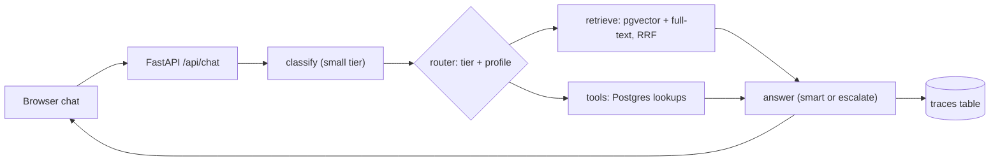
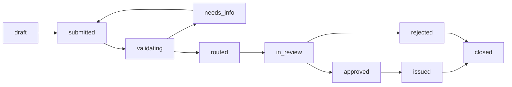

# City of San Diego — Municipality Agent (demo)

A resident-facing virtual assistant for a fictional City of San Diego. It answers
questions about permits, starting a business, trash pickup, service requests and
city events, and runs the back-office workflow when a resident uploads a form or
fills one in inside the chat. Every reply carries a trace: intent, model tier,
retrieved passages, tool calls, tokens, latency, cost.

## Demo in 60 seconds

```bash
cp .env.bedrock .env               # live default: Bedrock behind a LiteLLM gateway
                                   # (needs a Bedrock-capable AWS profile in
                                   #  ~/.aws/credentials — deploy/aws/README.md
                                   #  has the two commands that scope one)
docker compose up -d --build       # db, seaweedfs, litellm, api, web
curl localhost:8080/health         # wait for db/s3 = ok, status ok, kb_chunks 133
```

`GET /health` is free and anonymous: process, database, object store, the KB
chunk count and any startup step that failed. It makes **no model call** — a
stranger polling it should not be able to spend money — and answers 503 with
`status: degraded` when the database or S3 is down, so a load balancer can pull
the process out. The model and embedding probe moved to `GET /health/deep`,
which is staff-only (sign in at `/login` first) and cached for 60 seconds
because both halves cost real tokens.

Offline instead, no keys and no spend:

```bash
bash scripts/setup_ollama.sh       # pulls qwen2.5:3b / 7b / nomic-embed-text
cp .env.ollama .env && bash scripts/reset_demo.sh --build
```

Resident chat <http://localhost:3001>. The staff console is a separate section:
queue `/staff`, reporting `/staff/dashboard`, traces `/staff/traces`, reached
through the "City staff sign-in" line under the chat or `/login` directly
(`staff` / `staff` on the shipped profiles). `/traces` redirects to
`/staff/traces` for anything that bookmarked the old URL.

Three things to try: (1) "What day is my trash picked up at 4521 Adams Ave?", then
open the trace; (2) "How much is a business tax certificate for 3 employees?"; (3)
attach `api/forms/sample_permit_application.pdf` and send it, then watch it move
through the staff queue (`api/forms/sample_stro_application.pdf` does the same for
a short-term rental licence). `bash scripts/reset_demo.sh` restores the seeded state.

## Architecture

A Next.js chat UI calls a FastAPI backend. Each message is classified by a small
model into an intent and routed to a domain agent profile (system prompt plus an
allow-list of tools). Facts that live in SQL (trash zones, permit status, events,
fees) are answered by **tool calls**; policy and FAQ text by **RAG** over a
pgvector knowledge base. A **model router** picks the tier: small for
classification and extraction, smart for answers, escalate for hard or
low-confidence turns. Uploaded documents go to **SeaweedFS** (S3 API); extracted
fields go to Postgres, where a **state-machine workflow engine** advances
applications — four types share one status spine: building permit, business tax
certificate, short-term rental (STRO) licence and Get It Done service request —
and writes a certificate PDF back into SeaweedFS. The LLM client
speaks the OpenAI protocol, so the provider is an env-var swap: Ollama (dev),
OpenAI (key), or Bedrock behind a LiteLLM gateway (AWS demo). The chat page reads
`POST /api/chat/stream`, a server-sent-event version of the same turn, so the
answer types itself out instead of landing in one lump after several seconds;
`POST /api/chat` returns the identical body in one piece for the evals and scripts.





`submitted → validating → needs_info|routed → in_review` runs automatically in a
polling worker inside the API process. The rest are staff buttons.

## Model routing

Tiers are logical roles; the concrete model behind each comes from `.env`.

| Tier env var | Role | Ollama (dev) | OpenAI | Bedrock via LiteLLM (live) |
|---|---|---|---|---|
| `LLM_MODEL_SMALL` | intent classification, JSON-only tasks | `qwen2.5:3b` | `gpt-5-mini` | `us.anthropic.claude-haiku-4-5` |
| `LLM_MODEL_SMART` | resident-facing answers with tools and RAG | `qwen2.5:7b` | `gpt-5` | `us.anthropic.claude-sonnet-4-6` |
| `LLM_MODEL_ESCALATE` | complex, low-confidence or multi-intent turns | `qwen2.5:7b` | `gpt-5` | `us.anthropic.claude-opus-4-6` |
| `LLM_MODEL_EXTRACT` | long-document extraction | `qwen2.5:7b-32k` | `gpt-5-mini` | `us.amazon.nova-lite-v1:0` |

Extraction is the one tier that is not Claude: **Amazon Nova Lite** reads uploaded
forms because it has a 300k-token window at $0.06/$0.24 per 1M tokens — a
sixteenth of Haiku's input price — and it filled all 13 fields of the sample
business tax application. Embeddings are `amazon.titan-embed-text-v2:0` (1024
dims). Per-1M prices for all five live in `LLM_PRICES_JSON` in `.env.bedrock`,
which is what the `cost_usd` on every trace is computed from.

The rules live in `api/app/llm/router.py` and land on every trace: classify on
the small tier, then escalate if confidence is below 0.6, the classifier called
the turn high complexity, or it found more than one intent. The one non-model
shortcut is a tracking-number regex: `PRM-`/`BTC-`/`SR-`/`STR-` literally is the domain.

## Swapping providers

```bash
cp .env.ollama .env && bash scripts/reset_demo.sh --build     # local, free, weaker
cp .env.openai .env && bash scripts/reset_demo.sh --build     # set LLM_API_KEY first
cp .env.bedrock .env && bash scripts/reset_demo.sh --build    # the live default
```

`.env.bedrock` sets `COMPOSE_PROFILES=aws`, so the plain compose command also
starts the LiteLLM gateway; `.env.ollama` leaves it out. The api's `depends_on`
for `litellm` is `required: false`, so it waits for the gateway on the Bedrock
profile and ignores it on the others.

The catch is `EMBED_DIM`: the `kb_chunks.embedding` column is sized when the
migration runs (768 nomic, 1536 OpenAI, 1024 Titan), so changing embedding
providers needs a fresh database: `bash scripts/reset_demo.sh`. Since M26b the
API checks that width against `EMBED_DIM` on every startup and refuses to come
up on a mismatch, naming both numbers — it used to fail much later and much less
clearly, on the first insert of a knowledge-base ingest.

The Bedrock path runs a LiteLLM gateway (`deploy/aws/litellm.yaml`) mapping tier
aliases to Bedrock model ids and speaking OpenAI back to the API. Its
`router_settings.fallbacks` send the `escalate` tier to Sonnet when Opus is
throttled; every model id is a `us.` cross-region inference profile, so Bedrock
already handles a regional event itself.
`deploy/aws/up.sh` runs the same stack on one EC2 box; see
[`deploy/aws/README.md`](deploy/aws/README.md).

## Staff console and reporting

The resident app at `/` and the staff console under `/staff` are two different
products in one deployment, and since M21 they look like it: the resident nav is
the seal, the title, the demo badge and the health pill, with nothing a resident
can click and be bounced to a login for, and the console has its own nav (Queue,
Dashboard, Traces, who is signed in, Sign out) and one sign-in gate in
`web/app/staff/layout.tsx`.

`/staff/dashboard` is the reporting page. It draws one call, `GET
/api/reports/summary?days=<1..90>` (staff-only, 422 outside the bounds), which
returns `totals` (turns, conversations, cost, latency p50/p95, error turns,
fallback turns), `by_day`, `by_intent`, `by_tier`, `tools` (calls, errors and the
share answered by live City data), `citation_rate`, `applications` (type x status,
median hours from submitted to in_review, issued, needs_info) and `unanswered` —
the last ten real questions answered with no tool result and no retrieved chunk,
or answered by handing over the City's general line. That list is the input to the
next round of knowledge-base writing. Every figure is one SQL aggregate over
`traces`, `chat_messages`, `applications` and `application_events`; the charts are
inline SVG, so the page adds no dependency.

## Staff login

The chat is open to anyone. The staff console is not: it can
approve applications, issue certificates and read every resident conversation, so
they sit behind a real login rather than a shared passcode. Sign in at `/login`;
the API checks the password against a `hashlib.scrypt` hash (Python standard
library, salt inside the hash string — no new dependency), and returns a session
as an HttpOnly, SameSite=Lax cookie that expires after 12 hours. Only the sha256
of the token is stored, a wrong password is one generic 401 after a one-second
pause, and a sixth failure for the same username inside a minute is a 429.
`application_events.actor` records the signed-in username, so the timeline in the
detail panel names the person who issued a certificate.

| Variable | Default | Purpose |
|---|---|---|
| `STAFF_USERNAME` | `staff` | The single back-office account |
| `STAFF_PASSWORD` | `staff` (a generated value in `.env.example`) | Re-hashed at every startup, so changing it here changes the login |
| `STAFF_DISPLAY_NAME` | `City Staff` | Shown in the nav when signed in |
| `WEB_ORIGIN` | `http://localhost:3001` | Exact browser origin(s) allowed to send the cookie, comma-separated. A CORS wildcard cannot carry credentials, so this cannot be `*`; the shipped profiles add `http://localhost:3002` for the Playwright dev server |

The seed loader upserts that one user at startup and never truncates the staff
tables, so `bash scripts/reset_demo.sh` does not log you out mid-demo. There is
one account and no roles: real staff auth would be SSO plus per-record authz (see
Limitations).

## Live data

The applications, the fee tables and the twelve collection zones are fictional. The
map answers are not: since M8 the assistant reads real City of San Diego services,
all public and unauthenticated, through `api/app/live/`.

| Question | Real source | If it fails |
|---|---|---|
| Address to a point and a ZIP | ArcGIS `Locators/StreetAddress` geocoder | falls back to a bare 5-digit ZIP in the text, then to "I couldn't find that" |
| Who is my council member? | `DoIT_Public/DoIT_Public` layer 5, point-in-polygon | the fictional `council_districts` seed table (`source: "seed"`) |
| When is street sweeping? | `GeoSweep/GeoSweep_Dynamic` layer 13, by street name and address range | "the City's layer has no posted route for that street" |
| What is this parcel zoned? | `DSD/Zoning_Base` layer 0, point query | a clean error, never a guess |
| Any permits on file here? | `DoIT_Public/DSDPermits` layer 0, by address | "no records matching" |
| When is the next council meeting? | Granicus agenda RSS, merged into `search_events` | the seed events alone |
| Anything else on sandiego.gov | `search_city_website` (see below) | the referral line or 619-236-5555 |
| When is my trash collected? | **no real source exists** — the City publishes no per-address collection day | always the fictional zones; a geocoded or ZIP-only address is answered at ZIP level and told to confirm at [getitdone.sandiego.gov/CollectionMapLookup](https://getitdone.sandiego.gov/CollectionMapLookup) |

Every live call has a 4-second timeout and a 10-minute in-process cache, and every
failure returns seed data or `{"error": ...}` — never a 500. `LIVE_DATA_ENABLED=false`
turns the whole module off, which is how the test suite runs (no test opens a socket)
and how the demo works on a plane. A tool result carries `source: "live"` or
`source: "seed"`, the preamble makes the model say which, and both show in the trace
panel next to the tool name.

**Web search.** `search_city_website` is the last resort, offered to every profile after
the knowledge base and the other tools. It sends `<query> site:sandiego.gov` to the
provider named by `SEARCH_PROVIDER`, drops any result outside `*.sandiego.gov`, fetches
the top two pages, strips the tags with the standard library and returns the first 3,000
characters of each as a **source** — numbered into the same `Sources:` block as the KB
chunks, so the model cites a fetched City page as `[3]` exactly like a KB passage. Set
`SEARCH_PROVIDER=brave` and `SEARCH_API_KEY=<key>` from
[brave.com/search/api](https://brave.com/search/api/) to turn it on; the default
`SEARCH_PROVIDER=none` makes the tool report "web search is not configured", and the
model falls back to the referral line rather than answering from memory.

## Evals

`cd api && uv run python -m evals.run --base-url http://localhost:8080`

59 questions in `api/evals/golden.json`, 40 dev and 19 held out. Scoring is
mechanical: intent match, expected tool(s) called, citations present when the item
expects RAG, a loose keyword check, and a literal phrase guardrail. No LLM judge,
because the local model is weak and a judge built on it would be weaker.

Latest run (2026-09-05, Bedrock, after M6-M10; five red-team items 55-59 added later, three re-run and passing): standard n=32 intent 96.9% tool 100%
citations 100% keywords 100% guardrail 100% ($0.74); multi_intent tool 50% -> 100% and
multi_turn tool 83% -> 100% after M10 (allow-list and schema fixes, not prompt tuning). The
pre-M6 baseline was 93.3/93.3/96.7/96.7 on standard. Nothing was tuned to an item.

`python -m evals.run` accepts `--split`, `--category` and `--ids 56,57,58` so one item can be re-run for a few cents. Every item carries a `category`, and the runner reports all five metrics per
category as well as per split. **standard** (32) is the original single-turn
question set plus the two M8 address items. **adversarial** (10) is out-of-scope or hostile input — prompt
injection, an address and a tracking number that do not exist, "write me a poem",
legal advice, another city's collection day, a topic the KB does not cover — scored
with `must_not_contain` phrases (e.g. "generally speaking") and `must_contain_any`
phrases (e.g. "couldn't find", "619-236-5555") so a refusal can be checked without
a judge. **multi_turn** (6) sends a list of `turns` on one session and scores the
last reply, so "and recycling?" has to resolve against the address given a turn
earlier. **multi_intent** (6) asks two things in one message and names several
`tools`, every one of which must be called at least once across the turns.

**The evals report, they do not gate, and nothing is tuned to them.** No prompt,
router rule or KB file is edited because a golden item failed; root causes that
generalise get fixed and logged in `DECISIONS.md`. That happened once, to inject
today's date into the system prompt.

### Ollama qwen2.5:7b vs Bedrock Claude

Same 30 questions (the `standard` category, before the M9 expansion), same
prompts, same router, same day. The only thing that changed between the two runs
is `.env`.

| Split | n | Provider | Intent | Tool | Citations | Keywords | Mean latency | Total cost |
|---|---|---|---|---|---|---|---|---|
| dev | 20 | Ollama qwen2.5:7b | 80.0% | 80.0% | 100.0% | 100.0% | 6.8 s | $0.0000 |
| dev | 20 | Bedrock Claude | **95.0%** | **90.0%** | 100.0% | 100.0% | 6.1 s | $0.3486 |
| holdout | 10 | Ollama qwen2.5:7b | 90.0% | 90.0% | 100.0% | 100.0% | 6.0 s | $0.0000 |
| holdout | 10 | Bedrock Claude | 90.0% | **100.0%** | 100.0% | 100.0% | 6.3 s | $0.1505 |

Bedrock Claude = Haiku 4.5 classifying, Sonnet 4.6 answering, Opus 4.6 on
escalated turns. All 30 questions cost **$0.4991**, about 1.7 cents a turn.
Latency is a wash: the local 7B is slow because it is a 7B on a laptop, and the
Bedrock path spends most of its 6 seconds generating a longer, better answer.
What money buys here is classification and tool selection, not speed.

## CI

[](https://github.com/aeisenman/civic-assistant-demo/actions/workflows/api.yml)
[](https://github.com/aeisenman/civic-assistant-demo/actions/workflows/web.yml)
[](https://github.com/aeisenman/civic-assistant-demo/actions/workflows/compose-smoke.yml)
[](https://github.com/aeisenman/civic-assistant-demo/actions/workflows/security.yml)

Four checks on every pull request: **api** (ruff + 452 tests), **web** (tsc,
eslint, `next build`), **compose-smoke** and **security**. None of them calls a
real model, so a PR costs minutes and nothing else.

**compose-smoke** brings up the whole default stack — `db seaweedfs api web`,
no `aws` profile — against `scripts/ci/stub_openai.py`, waits for `/health` and
for the web container to report healthy, then runs `scripts/smoke.sh` in
`SMOKE_MODEL=stub` mode (health, forms schema, document upload, an application
filed through the inline form, the worker routing it to `in_review`, staff
sign-in, two advances, certificate PDF) and a 20-concurrent-stream probe. It
runs twice, at `EMBED_DIM` 768 and 1024, because that number is baked into the
vector column by migration 002 and prod runs 1024.

**security** is pip-audit, npm audit, gitleaks and a Trivy scan of both built
images at HIGH/CRITICAL — the only job that can see a CVE in a base layer.

Two more — `e2e` and `eval-nightly` — spend Bedrock money and are opt-in. They
need an OIDC role that does not exist yet; until the secret is set they fail
with a message naming it rather than skipping green, which is what they used to
do and what made the nightly eval decorative.

Full detail, including the branch-protection settings to click:
[`scripts/ci/README.md`](scripts/ci/README.md). The badges above are blank for
anyone not signed in, because the repo is private.

## Backups, restore, migrations

`bash scripts/backup.sh [label]` writes `data/backups/<timestamp>-<label>/`:
`dump.pgc` (a `pg_dump -Fc` taken inside the db container, so no local Postgres
client is needed) and `seaweed.tar.gz`. `scripts/reset_demo.sh` calls it before
it deletes anything.

`bash scripts/restore.sh [--keep] [backup-dir]` is the drill. It restores the
newest dump into a scratch database `civic_restore` beside the live one and
prints the row counts side by side, then drops the scratch database again. It
never writes to `civic`. Last run, 2026-09-15, against the 09-14 backup:

| table | civic | civic_restore |
|---|---|---|
| `applications` | 73 | 12 |
| `traces` | 515 | 17 |
| `kb_chunks` | 133 | 120 |

(The columns differ by everything the live stack has written since; what the
drill proves is that the dump restores at all and every table came back.)

Migrations are plain SQL in `api/app/db/migrations/`, applied in filename order
at startup under a `pg_advisory_lock`. `006` and `007` have a paired
`.down.sql`; `python -m app.db.migrations --rollback 007_m19.sql` runs it and
deletes the `schema_migrations` row in one transaction.

## Repo map

| Path | What is in it |
|---|---|
| `api/` | FastAPI service (`app/`, including `app/live/` for real City data), KB markdown (`kb/`), seed JSON (`seed_data/`), sample form PDFs (`forms/`), golden evals (`evals/`), 301 tests (`tests/`) |
| `web/` | Next.js app: the resident chat at `/`, the staff console (queue, reporting dashboard, traces) under `/staff` |
| `scripts/` | `setup_ollama.sh`, `smoke.sh`, `reset_demo.sh`, `backup.sh`, `restore.sh`, `spend.sh`, `demo_up.sh`, and `ci/` (the CI helpers and workflow docs) |
| `deploy/` | `aws/`: EC2 + Bedrock deployment scripts and the LiteLLM gateway config |
| `docs/` | Design decisions, architecture, file-by-file explainer, demo script, build log |
| `research/` | Source research on real San Diego permits, business tax, trash and 311 |

## Limitations, and what production would need

- **Auth.** One seeded staff account with a scrypt password and a 12-hour cookie
  session (M11). A resident still has no account, but a conversation is no longer
  open to anyone who learns its id: since M20 the first browser to use a
  `session_id` is given a `resident_session` cookie (an HMAC of the id under
  `SESSION_SECRET`) and every later request on that id must present it, or the API
  answers 403. Real deployments need staff SSO, roles, identity-verified residents
  and per-record authz; the failed-login counter is per process, which a second API
  replica would defeat.
- **OCR.** Scanned PDFs are stored and reported as unreadable. Textract would
  close the most common real intake path.
- **Real integrations.** Permit *applications*, business tax, short-term rental
  (STRO) licences and 311 are Postgres tables here; production means Accela, SAP and Salesforce connectors, plus the
  retry and reconciliation work that implies. The read-only map lookups (district,
  sweeping, zoning, permit records) already hit the real City services; there is no
  public write API for Get It Done, and no public source at all for a per-address
  trash collection day, so those two stay simulated.
- **Latency.** Replies stream token by token since M12, but the classifier runs
  before the first one, so a resident still waits on a full small-model call
  before anything appears.
- **Abuse and cost limits.** Per-IP token bucket (`RATE_LIMIT_BURST` 20, then
  `RATE_LIMIT_PER_MINUTE` 30) in front of chat, upload and filing; a semaphore of
  `MAX_CONCURRENT_STREAMS` on the stream route that answers 429 with `Retry-After`
  rather than queueing; a per-session turn cap and a daily spend breaker. The
  bucket lives in Postgres so it holds across replicas, but it keys on IP, which
  one NAT'd office shares and one botnet defeats — production wants it in front of
  the app (WAF or ALB rules) with the in-app bucket as the backstop.
- **Duplicate filings.** `POST /api/applications` honours an `Idempotency-Key`
  header (the web form sends one per submit) and, without a key, treats an
  identical payload from the same conversation inside 60 s as the same filing.
  Nothing yet deduplicates the same pothole reported by two different residents.
- **PII and retention.** Names, addresses, emails and phones land in traces in the
  clear, and `/api/traces` returns all of it to any staff session — one role, no
  RBAC. `TRACE_RETENTION_DAYS` adds a nightly sweep of `traces` and
  `chat_messages` and defaults to `0` (keep everything) for the demo; a real City
  would set it no lower than 730, because California expects records of a resident
  interaction to be kept two years. Still needed: redaction at write time, roles on
  the traces endpoint, and a provider agreement.
- **Human review.** Approve and reject are one click: no second signature, note
  requirement or queue assignment.
- **Monitoring.** Traces are the only observability. Production wants metrics,
  alerting on tool-error rates and classifier drift, turn replay.
- **Evaluation at scale.** 54 hand-written questions is a smoke test; real work
  means a far larger set sampled from actual traffic.

## Credits

Built with Claude Code. Research on real San Diego processes is in `research/`
with source URLs; the city, its data and every application in it are fictional.
`docs/BUILD_LOG.md` says how this was actually assembled.
